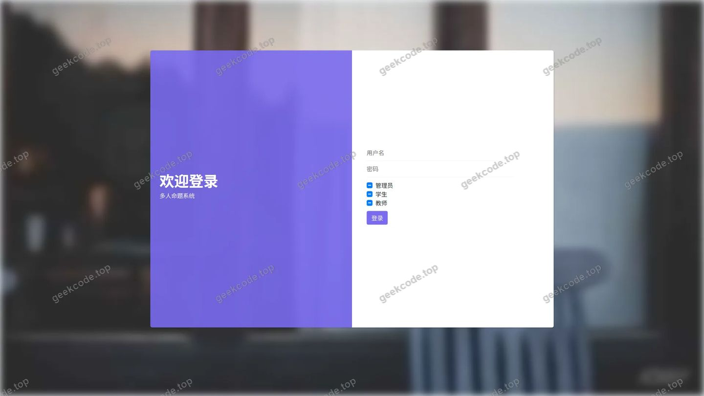
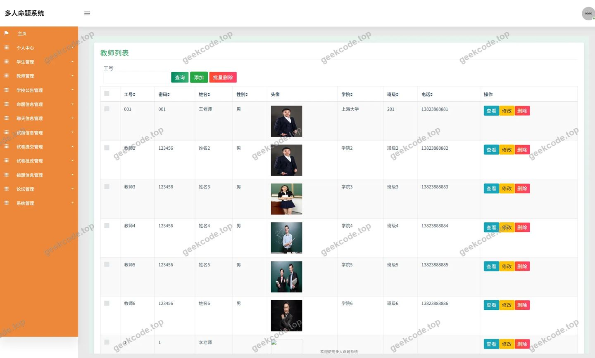
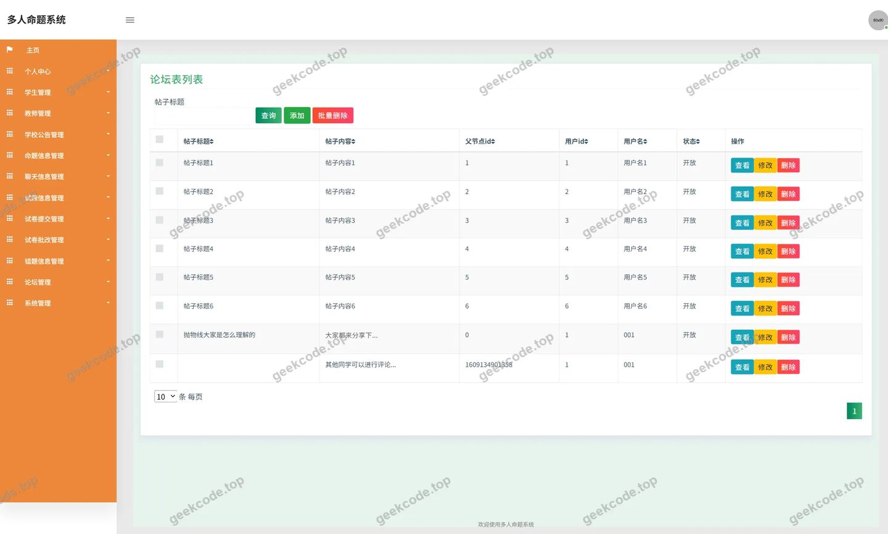
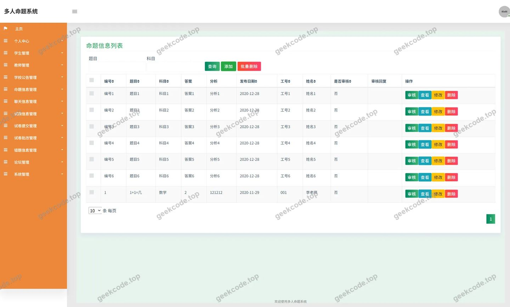
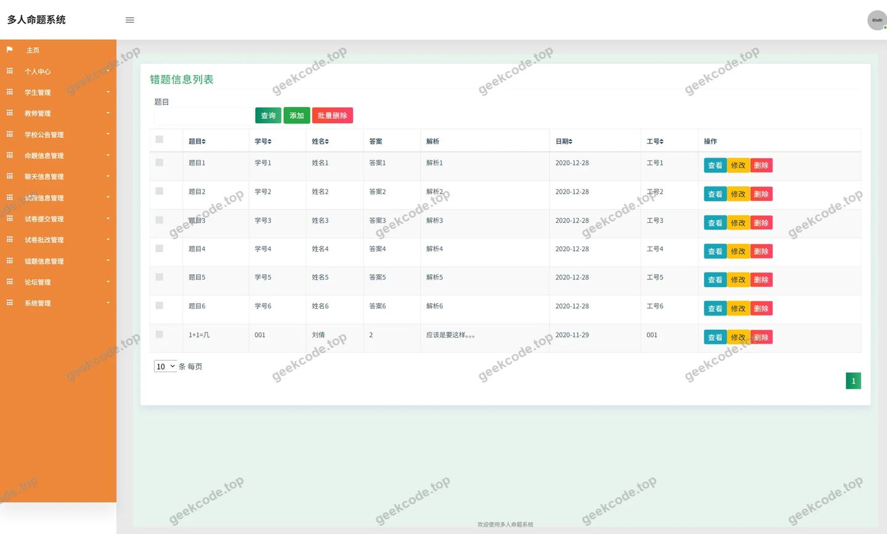
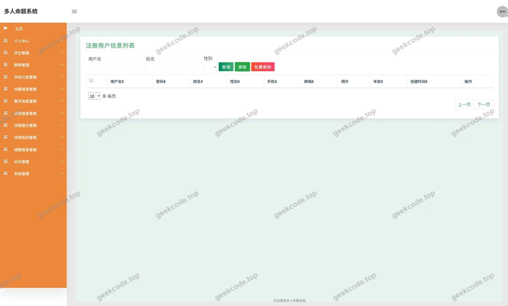
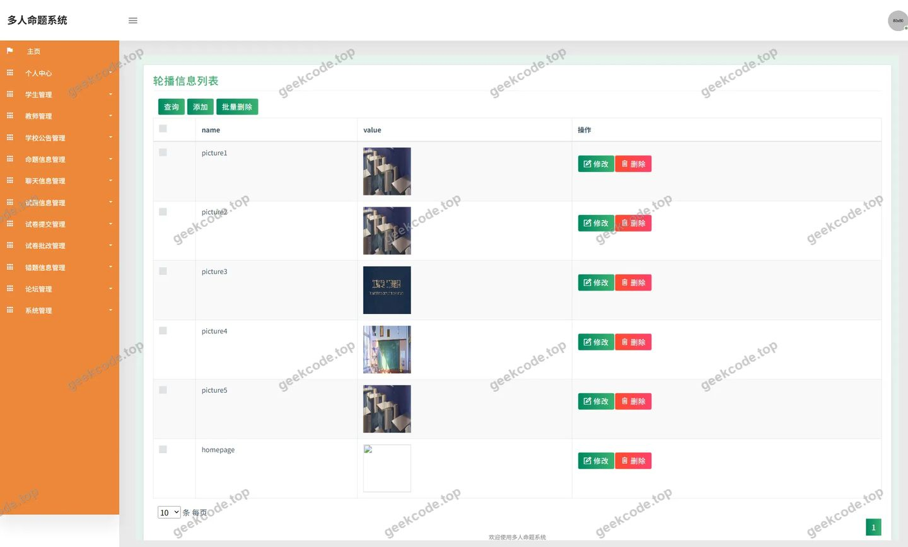
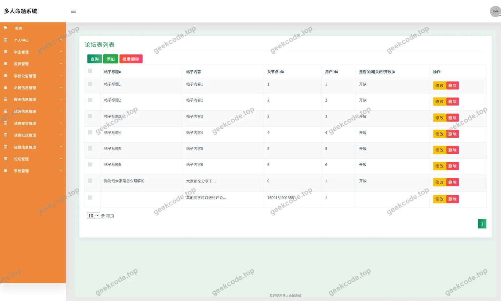

# 多人命题系统

> 🎓 **计算机毕业设计 · 多人命题系统**
>
> 本仓库只放**项目介绍 + 运行截图**（截图是站点带水印的原图，存在仓库 `images/` 里）。
>
> 👉 **完整可运行源码 / 数据库脚本 / 部署文档：[点我获取](https://geekcode.top/archives/%E5%A4%9A%E4%BA%BA%E5%91%BD%E9%A2%98%E7%B3%BB%E7%BB%9F?utm_source=github)**
>
> 💬 咨询微信：**ir9372**　|　🌐 更多项目：[极客代码 geekcode.top](https://geekcode.top/?utm_source=github)
>
> 📌 项目详情页：<https://geekcode.top/archives/%E5%A4%9A%E4%BA%BA%E5%91%BD%E9%A2%98%E7%B3%BB%E7%BB%9F?utm_source=github>

<table><td width="230" align="center"> <b>扫码加微信 ir9372</b></td><td valign="middle">📦 源码 = 项目介绍 + 全部运行截图 + 数据库 + 部署文档 👉 点上方任意截图，直接跳到 <b>极客代码 geekcode.top</b> 详情页</td></table>

---

<h1>多人命题系统</h1>
<h2>项目概述</h2>

多人命题系统是一款基于 Java 后端技术构建的纯 API 服务项目，旨在为教育机构提供高效的在线命题、试卷管理及师生互动平台。系统核心功能涵盖试题信息管理、论坛交流、即时聊天以及试卷提交与批改流程。适用人群主要包括教师（负责命题与批改）、学生（参与答题与交流）及系统管理员（配置与维护）。在技术架构上，项目采用 Spring Boot 框架作为基础支撑，结合 MyBatis-Plus 实现数据持久化操作，并使用 Druid 作为数据库连接池以保障高并发下的稳定性。该项目专注于后端业务逻辑处理与数据接口服务，不包含独立的前端页面渲染或后台管理界面，通过标准化 API 接口与前端应用进行交互，体现了前后端分离的开发理念。

<h2>技术架构</h2>

本项目采用典型的后端分层架构设计，主要包含表现层（Controller）、业务逻辑层（Service，隐含于 Controller 调用中）和数据访问层（DAO/Mapper）。

<strong>核心技术选型：</strong>

<ol>
<li><strong>Spring Framework</strong>: 利用 <code>spring-core</code>, <code>spring-context</code>, <code>spring-web</code>, <code>spring-webmvc</code> 等模块构建轻量级 Web 容器，负责请求分发、依赖注入及事务管理。<code>spring-aop</code> 用于切面编程，增强日志记录或权限校验能力；<code>spring-tx</code> 确保数据操作的原子性。</li>
<li><strong>MyBatis-Plus</strong>: 作为 ORM 框架，简化了 SQL 编写过程，提供了通用的 CRUD 操作接口，提高了开发效率并减少了代码冗余。</li>
<li><strong>Druid</strong>: 阿里巴巴开源的高性能 JDBC 连接池，具备强大的监控和扩展功能，能有效管理数据库连接资源，提升系统吞吐量。</li>
</ol>

<strong>数据库设计要点：</strong>
根据控制器命名推断，数据库主要包含以下实体表：

<ul>
<li><strong>用户表 (<code>User</code>)</strong>: 存储管理员、教师、学生等不同角色的基本信息及认证凭证。</li>
<li><strong>命题信息表 (<code>Mingtixinxi</code>)</strong>: 存储试题内容、类型、难度及所属科目等信息。</li>
<li><strong>试卷提交表 (<code>Shijuantijiao</code>)</strong>: 记录学生提交的试卷数据及状态。</li>
<li><strong>试卷批改表 (<code>Shijuanpigai</code>)</strong>: 存储教师对试卷的评分、评语及批改时间。</li>
<li><strong>论坛/聊天表 (<code>Forum</code>, <code>Liaotianxinxi</code>)</strong>: 支持师生间的学术交流与即时通讯。</li>
<li><strong>配置表 (<code>Config</code>)</strong>: 管理系统全局参数，如轮播图配置 (<code>lunbotuguanli</code>) 等。</li>
</ul>

<strong>Mermaid 架构图：</strong>

<pre><code class="language-mermaid">graph TD
    Client[客户端应用] --&gt;|HTTP Request| API[API Gateway / Controller Layer]
    subgraph Backend [Spring Boot Application]
        API --&gt; Service[Business Logic]
        Service --&gt; Mapper[MyBatis-Plus Mapper]
        Mapper --&gt; DB[(MySQL Database)]
        Service --&gt; Cache[Optional Cache]
    end
    DB  Druid[Druid Connection Pool]
    API -.-&gt;|Response JSON| Client
</code></pre>
<h2>功能模块</h2>

由于项目类型为 pure-api 且无独立前后台界面，以下功能模块均指后端提供的接口服务能力，供前端调用。

<h3>用户端功能（对应前台导航及个人中心）</h3>
<ol>
<li><strong>身份认证模块</strong></li>
</ol>
<ul>
<li><strong>登录接口</strong>: 提供用户名密码验证机制，区分不同角色（学生、教师、默认用户）的登录入口。</li>
<li><strong>个人中心</strong>: 获取当前登录用户的详细信息，支持修改个人资料。</li>
<li><strong>我的发布</strong>: 查询用户发布的论坛帖子或上传的文件记录。</li>
</ul>
<ol start="2">
<li><strong>教学业务模块</strong></li>
</ol>
<ul>
<li><strong>试题信息查询</strong>: 提供试题列表展示、详情查看接口，支持按条件筛选（对应“试题信息”菜单）。</li>
<li><strong>学校公告</strong>: 获取系统发布的最新通知与公告列表。</li>
<li><strong>论坛交流</strong>: 支持发帖、回帖、浏览论坛主题（对应“论坛信息”菜单），促进师生互动。</li>
<li><strong>聊天服务</strong>: 提供即时消息发送与接收接口，支持一对一或群组沟通（对应“聊天信息”截图）。</li>
</ul>
<ol start="3">
<li><strong>命题与评估模块</strong></li>
</ol>
<ul>
<li><strong>命题信息管理</strong>: 教师可创建、编辑、删除试题；学生可查看相关命题要求。</li>
<li><strong>试卷提交</strong>: 学生完成作答后，通过接口提交试卷数据。</li>
<li><strong>试卷批改</strong>: 教师接收待批改试卷，录入分数及评语，更新批改状态。</li>
</ul>
<h3>管理维护功能（隐含于 Controller 逻辑）</h3>

虽然无独立后台界面，但通过 <code>CommonController</code> 和 <code>ConfigController</code> 提供底层管理能力：

<ol>
<li><strong>文件服务</strong>: <code>FileController</code> 提供图片、文档等资源的上传与下载接口，支持轮播图管理 (<code>lunbotuguanli</code>) 所需的素材存储。</li>
<li><strong>系统配置</strong>: <code>ConfigController</code> 用于动态调整系统参数，如论坛开关、公告置顶规则等。</li>
<li><strong>通用工具</strong>: <code>CommonController</code> 可能包含字典数据查询、验证码生成等公共辅助接口。</li>
</ol>
<h2>用户角色与权限</h2>

根据控制器中的 <code>JiaoshiController</code> (教师)、<code>UserController</code> (用户) 及截图中的“学生”、“defaultuser”标识，系统主要划分为以下三类角色：

<table>
<thead>
<tr>
<th align="left">角色</th>
<th align="left">权限描述</th>
<th align="left">可访问功能模块</th>
</tr>
</thead>
<tbody><tr>
<td align="left"><strong>教师</strong></td>
<td align="left">拥有命题权、批改权及管理权。是系统的核心内容生产者。</td>
<td align="left">1. <strong>命题管理</strong>: 创建、修改、发布试题 (<code>Mingtixinxi</code>)。2. <strong>试卷批改</strong>: 查看学生提交的试卷，录入成绩与评语 (<code>Shijuanpigai</code>)。3. <strong>论坛管理</strong>: 发布官方话题，回复学生疑问 (<code>Forum</code>)。4. <strong>聊天</strong>: 与学生进行实时沟通 (<code>Liaotianxinxi</code>)。5. <strong>个人中心</strong>: 维护个人信息。</td>
</tr>
<tr>
<td align="left"><strong>学生</strong></td>
<td align="left">拥有答题权、交流权及查看权。是系统的主要使用者。</td>
<td align="left">1. <strong>试题浏览</strong>: 查看已发布的试题信息 (<code>Shitixinxi</code>)。2. <strong>试卷提交</strong>: 在线作答并提交试卷 (<code>Shijuantijiao</code>)。3. <strong>论坛参与</strong>: 浏览公告，发布帖子，评论互动 (<code>Forum</code>)。4. <strong>聊天</strong>: 向教师或其他同学发送消息 (<code>Liaotianxinxi</code>)。5. <strong>个人中心</strong>: 查看“我的发布”，维护个人信息。</td>
</tr>
<tr>
<td align="left"><strong>管理员/默认用户</strong></td>
<td align="left">拥有最高系统权限，负责基础数据维护与配置。</td>
<td align="left">1. <strong>系统配置</strong>: 管理轮播图 (<code>lunbotuguanli</code>)、论坛设置 (<code>luntanguanli</code>)。2. <strong>用户管理</strong>: 审核注册信息，重置密码。3. <strong>文件管理</strong>: 上传和管理系统静态资源。4. <strong>全局视图</strong>: 查看所有命题、试卷及聊天记录。</td>
</tr>
</tbody></table>
<h2>项目特色与创新点</h2>
<ol>
<li><strong>高度解耦的 API 架构</strong>: 作为 Pure-API 项目，彻底实现了前后端分离。后端仅关注业务逻辑与数据完整性，不耦合任何视图层代码，使得同一套接口可同时服务于 Web 端、移动端 App 或小程序，极大提升了系统的复用性和扩展性。</li>
<li><strong>全流程在线考试闭环</strong>: 涵盖了从“教师命题”到“学生答题”再到“教师批改”的完整业务链条。特别是 <code>Shijuanpigai</code> 和 <code>Shijuantijiao</code> 控制器的存在，证明了系统不仅限于题库管理，更具备实际的考务处理能力。</li>
<li><strong>集成化的社区互动引擎</strong>: 将传统的考试系统与社交属性融合，通过 <code>Forum</code> 和 <code>Liaotianxinxi</code> 模块，构建了学习共同体。这种设计打破了单向输出的教学模式，促进了师生间的双向反馈与知识共享。</li>
<li><strong>稳健的数据访问层</strong>: 选用 MyBatis-Plus 配合 Druid 连接池，既保证了复杂查询的灵活性，又通过成熟的连接池技术确保了在高并发场景下数据库连接的稳定性与安全性，符合企业级应用的开发标准。</li>
</ol>
<h2>部署环境</h2>

为确保多人命题系统正常运行，需准备以下软件环境：

<ol>
<li><strong>操作系统</strong>: Windows Server, Linux (CentOS/Ubuntu), 或 macOS。</li>
<li><strong>Java 运行环境</strong>: JDK 1.8 或更高版本（推荐 JDK 8+，以兼容 Spring Boot 常见版本）。</li>
<li><strong>数据库</strong>: MySQL 5.7 或 MySQL 8.0。需初始化相应的库表结构，并配置正确的字符集（建议 utf8mb4）以支持中文存储。</li>
<li><strong>构建工具</strong>: Maven 3.6+ 或 Gradle，用于依赖管理和项目打包。</li>
<li><strong>Web 服务器</strong>: 内置 Tomcat（由 Spring Boot Starter Web 提供），无需单独安装外部 Web 服务器。若生产环境需要，可搭配 Nginx 进行反向代理。</li>
<li><strong>其他依赖</strong>:</li>
</ol>
<ul>
<li>数据库驱动: MySQL Connector/J。</li>
<li>缓存服务（可选）: 若启用 Redis 进行会话管理或热点数据缓存，需部署 Redis 服务。</li>
</ul>

<strong>注意</strong>: 由于项目无前端源码，部署时需配合独立的前端工程（Vue/React/Angular 等）共同使用，前端通过 HTTP 请求调用本系统提供的 RESTful API 接口。

<h2>五、技术特性</h2>
<ul>
<li>使用 MyBatis-Plus 简化数据访问层开发</li>
</ul>
<h2>六、功能模块截图</h2>
<h3>后台管理端</h3>
<h4>页面-登录</h4>

<h4>页面-教师</h4>

<h4>页面-聊天信息</h4>

<h4>页面-论坛</h4>

<h4>页面-命题信息</h4>

<h4>页面-学生</h4>

<h4>页面-defaultuser</h4>

<h4>页面-lunbotuguanli</h4>

<h4>页面-luntanguanli</h4>

---

## 获取完整源码

| 项目 | 说明 |
| --- | --- |
| 项目名 | 多人命题系统 |
| 运行截图 | 本文 9 张（站点带水印原图，仓库 `images/` 目录） |
| 完整源码 | [https://geekcode.top/archives/%E5%A4%9A%E4%BA%BA%E5%91%BD%E9%A2%98%E7%B3%BB%E7%BB%9F?utm_source=github](https://geekcode.top/archives/%E5%A4%9A%E4%BA%BA%E5%91%BD%E9%A2%98%E7%B3%BB%E7%BB%9F?utm_source=github) |
| 咨询微信 | **ir9372**（备注：jingpin-yuanma） |
| 更多项目 | [极客代码 geekcode.top](https://geekcode.top/?utm_source=github) |

> 需要源码、部署、改配置、跑不起来等问题，加微信 ir9372 沟通，说明项目名即可。
